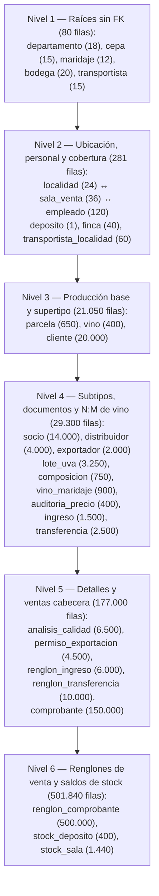

# Informe Técnico — Etapa 3: Carga Masiva y Reproducible de Datos

> **Trabajo Práctico Integrador · Bases de Datos · Ingeniería en Sistemas · UTN FRSR (Ciclo 2026)**
> **Sistema:** «Bodegas del Atuel»
> **Alcance:** Issues **#26, #27, #28, #29 y #30**

---

## 1. Resumen Ejecutivo

En la Etapa 3 se diseñó e implementó el subsistema de carga masiva, determinista y transaccionalmente consistente para las **31 tablas** del esquema relacional de «Bodegas del Atuel» (`001_esquema.sql` a `007_roles.sql`), alcanzando un volumen total de **729.551 registros** en **10,87 segundos** mediante el protocolo `COPY ... FROM STDIN` de PostgreSQL (`psycopg` v3), sin uso de ORM y con cumplimiento estricto de las reglas de negocio (`RN-01..RN-15`) e implícitas (`RI-01..RI-07`).

---

## 2. Catálogos Reales en CSV (Issue #26)

Los datos de referencia estáticos del dominio vitivinícola mendocino (Anexo B) se almacenan en archivos CSV codificados en UTF-8 sin BOM dentro de `db/seed/` y no se generan al azar:

| Archivo CSV | Tabla Destino | Filas | Contenido y Justificación |
| :--- | :--- | :---: | :--- |
| `departamentos.csv` | `departamento` | **18** | Los 18 departamentos oficiales de la provincia de Mendoza (Anexo B.3: `San Rafael`, `General Alvear`, `Malargüe`, `Luján de Cuyo`, `Maipú`, `Tupungato`, `Tunuyán`, `San Carlos`, `Lavalle`, `Rivadavia`, `Junín`, `San Martín`, `Santa Rosa`, `La Paz`, `Godoy Cruz`, `Guaymallén`, `Las Heras`, `Capital`). |
| `cepas.csv` | `cepa` | **15** | Las 12 cepas del Anexo B.1 (`7` tintas y `5` blancas) marcadas como activas en producción, más `3` cepas reales adicionales (`Petit Verdot`, `Cabernet Franc`, `Viognier`) sin parcelas ni composición para validar la consulta de borrado `D2`. |
| `maridajes.csv` | `maridaje` | **12** | Los 8 maridajes del Anexo B.2 más 4 maridajes gastronómicos adicionales con su temperatura de servicio (`8 °C` a `18 °C`). No incluye `'cordero al disco'` para permitir su creación condicional en la consulta `I2`. |
| `localidades.csv` | `localidad` | **24** | 24 localidades reales de Mendoza con su código postal oficial (`San Rafael` como sede del depósito central en `id_localidad = 1` y `General Alvear` en `id_localidad = 2` para `I1`). |
| `bodegas.csv` | `bodega` | **20** | 20 bodegas elaboradoras con CUIT de 11 dígitos válido (`30700000019` a `30700000202`) y domicilio en Mendoza. |
| `transportistas.csv` | `transportista` | **15** | 15 empresas logísticas con CUIT único (`30710000016` a `30710000155`), correo válido (`%_@_%`) y domicilio. |
| `tipos_vino_presentaciones.csv` | Catálogo auxiliar de `vino` | **20** | Producto cartesiano de los 4 `tipo_vino` (`tinto`, `blanco`, `rosado`, `espumante`) por las 5 presentaciones válidas (`187`, `375`, `750`, `1500`, `3000` ml) con precios base múltiplos de `100.00`. |

---

## 3. Orden Topológico de Carga por Dependencias FK (Issue #27)

El esquema físico posee **31 tablas** vinculadas por **37 claves foráneas**. El orden de carga se estructuró en **6 niveles topológicos** donde toda tabla se carga después de las tablas a las que referencia. El único ciclo del esquema (`localidad.cuit_encargado → empleado.cuit → sala_venta.id_sala → localidad.id_localidad`) se resuelve dentro de la misma transacción gracias a que `fk_localidad_encargado` está declarada `DEFERRABLE INITIALLY DEFERRED` en `001_esquema.sql`:

---

## 4. Algoritmo de Coherencia Temporal/Numérica y Estrategia frente a Triggers (Issue #28)

### 4.1 Por qué no se puede cargar el historial con los triggers activos

Mantener activos los triggers de `005_triggers.sql` durante una carga histórica de ~730.000 filas resulta inviable o semánticamente incorrecto por cuatro causas técnicas:

1. **Sobrescritura de fechas históricas (`RN-11`):** el trigger `trg_transferencia_fecha` ejecuta `NEW.fecha_confeccion := CURRENT_DATE` en todo `BEFORE INSERT ON transferencia`, impidiendo registrar transferencias de años anteriores o de los últimos 15 días (`S4`).
2. **Bloqueo de estados en documentos históricos (`RN-10`, `RN-11`):** `trg_fn_estado_avance` rechaza insertar filas directamente en `'terminado'` o `'procesado'`.
3. **Costo cuadrático $O(N^2)$ al `COMMIT` en constraint triggers diferidos (`RN-05`, `RI-01`, `RI-02`, totalidad de `cliente`):** los constraint triggers están definidos `FOR EACH ROW` y ejecutan un escaneo completo de la tabla al cerrar la transacción; insertar 20.000 clientes dispararía 20.000 escaneos completos de `cliente` y sus subtipos.
4. **Sobrecarga de `1.500.000` sentencias SQL en `renglon_comprobante` (`RN-08`, `RN-09`):** `trg_renglon_comprobante_bi` y `trg_renglon_comprobante_ai` ejecutan un `SELECT ... FOR UPDATE`, un `UPDATE stock_sala` y dos `UPDATE comprobante` por cada uno de los 500.000 renglones insertados.

### 4.2 Estrategia elegida: `DISABLE TRIGGER USER` transaccional + `SET CONSTRAINTS ALL IMMEDIATE`

Toda la carga se ejecuta dentro de un único bloque transaccional (`with conn.transaction():`):

1. `SET ROLE propietario;`
2. `TRUNCATE TABLE ... RESTART IDENTITY CASCADE;` sobre las 31 tablas.
3. `ALTER TABLE <tabla> DISABLE TRIGGER USER;` en las 31 tablas.
   - **Justificación frente a `DISABLE TRIGGER ALL` o `session_replication_role = replica`:** `DISABLE TRIGGER USER` desactiva únicamente los triggers PL/pgSQL escritos por el usuario, manteniendo **activos** todos los triggers internos de PostgreSQL que verifican las 37 `FOREIGN KEY`. Así cualquier violación referencial es abortada inmediatamente durante el `COPY`.
4. Carga por lotes mediante `COPY ... FROM STDIN` en orden topológico N1 → N6.
5. Sincronización de las 15 secuencias `GENERATED ALWAYS AS IDENTITY` mediante `setval(pg_get_serial_sequence(...), MAX(pk), true)`.
6. `SET CONSTRAINTS ALL IMMEDIATE;`: fuerza la validación inmediata de `fk_localidad_encargado` (`DEFERRABLE INITIALLY DEFERRED`), vaciando la cola de eventos pendientes de `localidad` para evitar el error `SQLSTATE 55006` (`cannot ALTER TABLE "localidad" because it has pending trigger events`) al rehabilitar los triggers.
7. `ALTER TABLE <tabla> ENABLE TRIGGER USER;`: deja todos los triggers activos (`tgenabled = 'O'`). Si cualquier paso previo falla, el `ROLLBACK` transaccional revierte incluso el `DISABLE TRIGGER USER`.
8. `REFRESH MATERIALIZED VIEW v_ventas_mensuales_sala;` y `ANALYZE;`.

### 4.3 Algoritmo *Bottom-Up* de conservación del stock y redondeo exacto

Dado que `ENABLE TRIGGER USER` no ejecuta retroactivamente los triggers sobre filas ya cargadas, `seed.py` garantiza por construcción todas las invariantes antes del `COPY` y luego las verifica con `consultas_control.sql`:

- **Conservación del stock y saldo acumulado diario $\ge 0$:**
  1. Se generan primero los `150.000` comprobantes y `500.000` renglones entre `2021-03-01` y `2026-10-30`, acumulando `demanda_sala[(id_sala, cod_vino)]`.
  2. Se define `stock_sala_final[(id_sala, cod_vino)]` (`32` vinos con stock $> 0$ y `8` vinos con stock $= 0$ por sala para `S6`).
  3. Se dimensionan las `2.350` transferencias en estado `'procesado'` en febrero de 2021 (previas al inicio de las ventas) más refuerzos en los últimos 15 días (`S4`), de forma que:
     $$\text{stock\_sala}(s, v) = \sum \text{renglon\_transferencia}_{\text{procesado}}(s, v) - \sum \text{renglon\_comprobante}(s, v) \ge 0$$
     y el saldo diario acumulado nunca sea negativo en ninguna fecha.
  4. Se fija `stock_deposito(v) > 0` para los 400 vinos y se dimensionan los `1.400` ingresos en estado `'procesado'` en enero de 2021 (antes de la primera transferencia) más entregas del último trimestre/mes (`I1`, `S7`), cumpliendo `RI-04` (vinos propios de cada bodega) y `RI-05` (cobertura de localidad del depósito):
     $$\text{stock\_deposito}(v) = \sum \text{renglon\_ingreso}_{\text{procesado}}(v) - \sum \text{renglon\_transferencia}_{\text{procesado}}(v) > 0$$
- **Aritmética decimal sin errores de centavo (`RN-08`, `RI-03`):**
  Todos los precios (`precio_anterior` y `precio_nuevo`) son múltiplos enteros de `100.00` y se operan con `Decimal` y `ROUND_HALF_UP`. Para descuentos del `10%`, `20%`, `30%` y `35%`, `importe_descuento` y `subtotal` resultan exactos sin fracciones de centavo, garantizando `comprobante.total == SUM(renglon_comprobante.subtotal)` en los 150.000 comprobantes.

---

## 5. Conteo Final de las 31 Tablas y Tiempos de Carga (Issue #29)

### 5.1 Volúmenes y tiempos medidos por tabla (`COPY ... FROM STDIN`)

| Nivel FK | Tabla | Filas Cargadas | Tiempo `COPY` (s) | Reglas y Casos Cubiertos |
| :---: | :--- | ---: | ---: | :--- |
| **N1** | `departamento` | 18 | 0,001 s | Anexo B.3 completo |
| **N1** | `cepa` | 15 | 0,001 s | 12 activas + 3 sin uso (`D2`) |
| **N1** | `maridaje` | 12 | 0,001 s | Sin `'cordero al disco'` (`I2`) |
| **N1** | `bodega` | 20 | 0,001 s | CUIT 11 dígitos válidos |
| **N1** | `transportista` | 15 | 0,001 s | CUIT único y email válido |
| **N2** | `localidad` | 24 | 0,001 s | Encargado único por localidad (`RN-02`, `RI-01`) |
| **N2** | `deposito` | 1 | 0,002 s | `id = 1` en San Rafael (`ck_deposito_id`) |
| **N2** | `sala_venta` | 36 | 0,002 s | $\ge 1$ por localidad; cierres lunes/miércoles (`U4`) |
| **N2** | `empleado` | 120 | 0,003 s | 24 encargados (`RI-01`) + antigüedades $>5$ y $<2$ años (`U2`, `D3`) |
| **N2** | `finca` | 40 | 0,002 s | Distribuidas en los 18 departamentos |
| **N2** | `transportista_localidad` | 60 | 0,002 s | Todos cubren depósito (`RI-05`); transp. 15 sin Gral. Alvear (`I1`) |
| **N3** | `parcela` | 650 | 0,054 s | Entidad débil `(id_finca, nro_parcela)`; solo cepas `1..12` |
| **N3** | `vino` | 400 | 0,049 s | 20 por bodega; precios múltiplos de `100.00`; incluye `'Malbec Reserva'` (`I6`) |
| **N3** | `cliente` | **20.000** | 0,241 s | **Supera 10.000 (#1)** (`14.000` socios, `4.000` dist., `2.000` exp.) |
| **N4** | `socio` | **14.000** | 0,145 s | **Supera 10.000 (#2)**; incluye socios sin compras (`D4`, `D6`) |
| **N4** | `distribuidor` | 4.000 | 0,082 s | `nro_habilitacion` único |
| **N4** | `exportador` | 2.000 | 0,059 s | Subtipo exportador (`RI-07`) |
| **N4** | `lote_uva` | 3.250 | 0,096 s | 650 parcelas × 5 campañas `2022..2026` (`RN-04`, `S10`) |
| **N4** | `composicion` | 750 | 0,058 s | Suma exactamente `100.00` por cada uno de los 400 vinos (`RN-05`) |
| **N4** | `vino_maridaje` | 900 | 0,014 s | Todos los 400 vinos con $\ge 2$ maridajes (`RI-02`) |
| **N4** | `auditoria_precio` | 400 | 0,049 s | 1 cambio histórico por vino el `2025-06-01` (`RN-13`, `RI-03`) |
| **N4** | `ingreso` | 1.500 | 0,064 s | `1.400` procesados (`D5`, `S7`), `50` terminados, `50` en confección |
| **N4** | `transferencia` | 2.500 | 0,060 s | `2.350` procesadas (`S4`), `75` terminadas, `75` en confección (`S5`) |
| **N5** | `analisis_calidad` | 6.500 | 0,055 s | 2 análisis por lote con `fecha >= fecha_cosecha` |
| **N5** | `permiso_exportacion` | 4.500 | 0,080 s | `500` exportadores con 4 permisos $\rightarrow 35\%$ (`RN-07`, `RI-06`, `U6`) |
| **N5** | `renglon_ingreso` | 6.000 | 0,110 s | 4 renglones por ingreso con vinos de su bodega (`RI-04`) |
| **N5** | `renglon_transferencia` | 10.000 | 0,149 s | 4 renglones por transferencia |
| **N5** | `comprobante` | **150.000** | 1,942 s | **Supera 10.000 (#3) y 100.000 (#1)** (`D1`, `S3`, `S8`, `S12`) |
| **N6** | `renglon_comprobante` | **500.000** | 6,253 s | **Supera 10.000 (#4) y 100.000 (#2)** (`S1`, `S2`, `S11`) |
| **N6** | `stock_deposito` | 400 | 0,005 s | Todos los 400 vinos con stock $> 0$ (`S6`) |
| **N6** | `stock_sala` | 1.440 | 0,060 s | 36 salas × 40 vinos (`32` con stock $> 0$ y `8` en `0` para `S6`) |
| — | **TOTAL (31 tablas)** | **729.551** | **10,870 s** | *(Incluye `TRUNCATE`, `COPY`, `setval`, `REFRESH` y `ANALYZE`)* |

### 5.2 Experimento comparativo: `fila por fila` vs `executemany` vs `COPY`

Sobre una muestra controlada de **10.000 filas** con estructura de `cliente` insertadas en PostgreSQL 16 (`seed.py --benchmark`), se registraron los siguientes tiempos empíricos:

| Método de Inserción | Filas | Tiempo Medido (s) | Rendimiento (filas/s) | Speedup vs Fila por Fila | Speedup vs `executemany` |
| :--- | :---: | :---: | :---: | :---: | :---: |
| **1. Fila por fila (`cur.execute`)** | 10.000 | `4,332 s` | `2.308,5 filas/s` | `1,00x` (base) | `0,18x` |
| **2. Por lotes (`cur.executemany`, lote=1.000)** | 10.000 | `0,760 s` | `13.152,6 filas/s` | **`5,70x`** | `1,00x` |
| **3. Flujo nativo (`COPY ... FROM STDIN`)** | 10.000 | **`0,067 s`** | **`148.875,3 filas/s`** | **`64,49x`** | **`11,32x`** |

- **Análisis:** La inserción fila por fila sufre la latencia de red (RTT) y el costo de planificación/ejecución de `10.000` sentencias individuales (proyectando más de 5 minutos para cargar 729.551 filas sin triggers, o más de 40 minutos con triggers activos). `COPY ... FROM STDIN` transmite un flujo continuo directamente al motor de almacenamiento de PostgreSQL, logrando una aceleración de **64,49 veces** frente a `cur.execute` y **11,32 veces** frente a `executemany`.

---

## 6. Consultas de Control, Reproducibilidad y Backup/Restauración (Issue #30)

### 6.1 Resultados de la batería de controles (`db/seed/consultas_control.sql`)

Al ejecutar `consultas_control.sql` tras la carga, los **14 controles (`C01..C14`)** devuelven exactamente **0 inconsistencias**:

| Código | Control de Integridad / Coherencia | Regla | Inconsistencias | Estado |
| :---: | :--- | :---: | :---: | :---: |
| **C01** | Stock negativo en `stock_sala` o `stock_deposito` | `RN-09` | `0` | **OK** |
| **C02** | Descuadre de `comprobante.subtotal` respecto de `SUM(cantidad * precio_unitario)` o comprobantes vacíos | `RN-08` | `0` | **OK** |
| **C03** | Descuadre de `comprobante.total` respecto de cabecera o `SUM(renglon_comprobante.subtotal)` | `RN-08` | `0` | **OK** |
| **C04** | Descuadre de `importe_descuento` o `subtotal` en `renglon_comprobante` | `RN-08` | `0` | **OK** |
| **C05** | Vinos sin composición o con `SUM(porcentaje) <> 100.00` | `RN-05` | `0` | **OK** |
| **C06** | Vinos sin maridaje asociado en `vino_maridaje` | `RI-02` | `0` | **OK** |
| **C07** | Encargado regional asignado a una sala fuera de su localidad | `RI-01` | `0` | **OK** |
| **C08** | Clientes sin fila única en su subtipo (`socio`, `distribuidor`, `exportador`) o con tipo discordante | `RI-07` | `0` | **OK** |
| **C09** | Clientes con `descuento <> fn_descuento_cliente(id_cliente)` | `RN-06`, `RI-06` | `0` | **OK** |
| **C10** | Vinos en `renglon_ingreso` ajenos a `ingreso.cuit_bodega` o transportista sin cobertura en depósito | `RI-04`, `RI-05` | `0` | **OK** |
| **C11** | Conciliación contable de `stock_deposito` y `stock_sala`, saldo diario acumulado $\ge 0$ y precios históricos | `RN-09`, `RI-03` | `0` | **OK** |
| **C12** | Coherencia temporal (`analisis >= cosecha`, `vencimiento > emision`, `venta >= alta_cliente`, `ingreso >= añada+1`) | `RN-04`, `RN-07` | `0` | **OK** |
| **C13** | Sincronización de las 15 secuencias `GENERATED ALWAYS AS IDENTITY` (`last_value >= MAX(pk)`) | Esquema | `0` | **OK** |
| **C14** | Todos los triggers de usuario habilitados post-carga (`tgenabled = 'O'` en `pg_trigger`) | `RN-05..RN-13` | `0` | **OK** |

### 6.2 Evidencia de reproducibilidad determinista (Corrida 1 vs Corrida 2)

Ejecutando dos veces consecutivas `python db/seed/seed.py --seed 42 --fecha-ref 2026-10-30`, los hashes MD5 calculados sobre el contenido íntegro ordenado de las tablas resultaron idénticos bit a bit:

| Tabla Evaluada | Filas | Hash MD5 Corrida 1 | Hash MD5 Corrida 2 | Coincidencia |
| :--- | ---: | :--- | :--- | :---: |
| `renglon_comprobante` | 500.000 | `0226ae4256d405cec9c949720ba47192` | `0226ae4256d405cec9c949720ba47192` | **Idéntico** |
| `comprobante` | 150.000 | `52aac7bc57152268fada7cbb820eacc2` | `52aac7bc57152268fada7cbb820eacc2` | **Idéntico** |
| `cliente` | 20.000 | `ece41bada2b60ceba457949bbca37b3f` | `ece41bada2b60ceba457949bbca37b3f` | **Idéntico** |
| `stock_sala` | 1.440 | `fd3e8b71d73150d97aaa964b9e20983c` | `fd3e8b71d73150d97aaa964b9e20983c` | **Idéntico** |
| `stock_deposito` | 400 | `7f682d92be309ff12de3efd5884e2bdb` | `7f682d92be309ff12de3efd5884e2bdb` | **Idéntico** |

### 6.3 Generación de `dump_completo.sql.gz` y prueba de restauración

Se generó el volcado comprimido con `pg_dump -U postgres -d atuel --no-owner --no-acl | gzip -9 > dump_completo.sql.gz` y se restauró en una base de datos limpia (`atuel_restore_test`). Al ejecutar `consultas_control.sql` sobre `atuel_restore_test`, se verificaron exactamente las **31 tablas con 729.551 filas totales** y **0 inconsistencias** en `C01..C14`.
