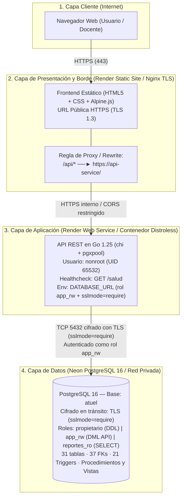

# Informe de la Etapa 8: Despliegue en la Nube, Seguridad y Operación · Bodegas del Atuel

> Trabajo Práctico Integrador · Bases de Datos · Ingeniería en Sistemas · UTN Facultad Regional San Rafael · Ciclo 2026.

---

## 1. Elección de Proveedor Cloud y Comparativa de Planes (Issue #57)

Para publicar en la nube las tres capas del sistema (**Base de Datos PostgreSQL 16**, **API REST en Go** y **Frontend estático en Alpine.js**) se relevaron y compararon cuatro alternativas bajo las condiciones vigentes de capa gratuita/educativa:

| Criterio | Opción 1: **Neon (PostgreSQL) + Render (API Web Service + Static Site)** *(Elegida PaaS)* | Opción 2: **Supabase (PostgreSQL) + Fly.io / Railway** | Opción 3: **VPS Linux con Docker Compose (AWS EC2 / GCP e2-micro / Oracle Cloud Free)** *(Alternativa IaaS)* | Opción 4: **Render Todo-en-Uno (Render Managed Postgres + Web + Static)** |
| :--- | :--- | :--- | :--- | :--- |
| **Motor de Base de Datos** | PostgreSQL 16 gestionado serverless (`Neon`) | PostgreSQL 15/16 gestionado (`Supabase`) | Contenedor oficial `postgres:16` sobre Docker en VM Linux | PostgreSQL 16 gestionado en Render |
| **Almacenamiento Gratuito** | **512 MB (0,5 GB)** por proyecto en el plan Free | **500 MB** por proyecto | **30 GB** (AWS/GCP Free Tier) a **200 GB** (OCI Always Free) | **1 GB**, pero la base gratuita **se destruye a los 30 días** |
| **Cómputo e Inactividad** | Neon: 190 h/mes de cómputo activo (auto-suspend tras 5 min sin uso y despertar automático en <500 ms). Render Web Service: 750 h/mes (spin-down tras 15 min sin tráfico) | Supabase: pausa el proyecto tras 7 días de inactividad (requiere reactivación manual en consola). Railway: crédito único de \$5 | Instancia activa 24/7 sin spin-down; exige mantenimiento manual de sistema operativo, actualizaciones y certificados | La base expira a los 30 días sin opción de renovación gratuita en la misma instancia |
| **Soporte de Roles, Triggers Diferidos y Vistas Materializadas** | **Completo:** PostgreSQL 16 estándar con soporte total de `CREATE ROLE`, `DEFERRABLE INITIALLY DEFERRED` y `MATERIALIZED VIEW` | Completo, pero el esquema `public` convive con esquemas internos de Supabase (`auth`, `storage`, `realtime`) | **Completo:** control absoluto del motor en contenedor dedicado | Completo mientras la instancia no expire |
| **Conexión Cifrada (TLS)** | **Obligatoria por defecto (`sslmode=require`)** con certificados válidos | Soportada (`sslmode=require`) | Requiere configurar TLS en PostgreSQL o aislar la base en una red bridge interna de Docker sin exponer `5432` | Soportada (`sslmode=require`) |
| **Requisito de Tarjeta de Crédito** | **No requiere tarjeta** ni en Neon ni en Render | Fly.io y AWS exigen tarjeta de crédito para activar la cuenta | Exige tarjeta de crédito internacional para verificación de identidad | No requiere tarjeta en plan Free |

### 1.1 Decisión Tomada y Justificación de Límites del Plan

Se eligió la combinación **Neon Serverless PostgreSQL 16 (Capa de Datos) + Render (Web Service en Go para la API + Static Site con Rewrite Proxy para el Frontend)** como arquitectura principal de nube gestionada (PaaS), complementada por la arquitectura de contenedor aislado en VPS con Docker Compose:

1. **Sin vencimiento a 30 días ni pausa semanal manual:** A diferencia de Render Postgres (que elimina la base gratuita a los 30 días) o Supabase (que pausa el proyecto a los 7 días y requiere reactivarlo desde el panel web), **Neon** mantiene los datos de forma permanente y reactiva el cómputo automáticamente ante cualquier consulta de la API.
2. **Capacidad suficiente para el dataset completo (`729.551` filas):**
   - El límite de almacenamiento de Neon Free es de **512 MB**.
   - Nuestra base de datos cargada con `seed.py --seed 42` (`729.551` filas distribuidas en las 31 tablas, incluyendo `500.000` renglones de comprobante, `150.000` comprobantes y los 5 índices de `008_indices.sql`) ocupa **~125 MB en disco**.
   - Esto permite alojar **el 100 % del dataset original en la nube** (o bien una carga reducida parametrizable con `seed.py` si se desea conservar mayor margen para pruebas de `pg_restore` en una segunda base dentro del mismo proyecto, superando holgadamente el piso de `10.000` filas exigido por la cátedra).
3. **Despliegue limpio del binario Go sin ORM:** Render construye directamente [`api/Dockerfile`](../../../api/Dockerfile) (`golang:1.25-alpine` $\rightarrow$ `gcr.io/distroless/static-debian12:nonroot`) e inyecta las variables de entorno de forma segura.

---

## 2. Estructura y Arquitectura Conceptual en la Nube

El sistema desplegado se organiza en tres niveles desacoplados que replican en producción la topología de desarrollo local:



### 2.1 Cómo interactúan los servicios

1. **Ingreso del usuario por HTTPS:** El usuario accede a la URL pública HTTPS del Frontend. El navegador descarga `index.html`, `estilos.css` y los módulos Alpine.js (`api.js`, `catalogo.js`, `vino.js`, `venta.js`, `transferencias.js`, `tablero.js`).
2. **Enrutamiento de peticiones a la API (`/api/*`):**
   - [`front/js/api.js`](../../../front/js/api.js) centraliza todas las llamadas bajo `const BASE = window.API_BASE || '/api'`.
   - En el servicio de Frontend se configura una regla de *Rewrite/Proxy* de `/api/*` hacia el servicio de la API (`/:splat`), idéntica al bloque `location /api/ { proxy_pass http://api:3333/; }` de [`front/nginx.conf`](../../../front/nginx.conf). De este modo el navegador opera bajo un único origen HTTPS sin latencia adicional de preflights CORS.
3. **Pool de conexiones seguro en la API Go:**
   - Al arrancar [`api/cmd/api/main.go`](../../../api/cmd/api/main.go), [`db.Open`](../../../api/internal/db/db.go) inicializa un pool `pgxpool` usando `DATABASE_URL`.
   - La cadena de conexión fuerza `sslmode=require` y utiliza exclusivamente el rol **`app_rw`**.
4. **Ejecución transaccional en PostgreSQL 16:**
   - Cada operación de negocio se ejecuta con parámetros ligados (`$1`, `$2`, ...) y, cuando abarca múltiples sentencias (`POST /vinos`, `POST /clientes`, `POST /comprobantes`, `POST /comprobantes/simular`), corre dentro de una transacción explícita (`tx, err := s.Pool.Begin(ctx)` ... `defer tx.Rollback(ctx)`).
   - Cualquier violación de `CHECK`, `UNIQUE`, `FOREIGN KEY` o `RAISE EXCEPTION` de un trigger es capturada por [`httperr.Write`](../../../api/internal/httperr/httperr.go), traducida a un mensaje claro en castellano con su código `SQLSTATE` y nombre de restricción, y devuelta con el código HTTP correspondiente (`409`, `422`, `400`, `503`).

---

## 3. Implementación de Seguridad (Issue #61)

| Control de Seguridad | Implementación Concreta en el Proyecto |
| :--- | :--- |
| **1. Principio de privilegios mínimos (`app_rw`)** | Definido en [`db/migrations/007_roles.sql`](../../../db/migrations/007_roles.sql): se ejecuta `REVOKE ALL ON SCHEMA public FROM PUBLIC;` y todas las tablas, vistas y rutinas pasan a ser propiedad del rol sin login `propietario`. El rol `app_rw` (usado por la API) solo recibe `USAGE` en el esquema, `SELECT, INSERT, UPDATE, DELETE` en tablas, `USAGE, SELECT` en secuencias y `EXECUTE` en funciones/procedimientos. No puede ejecutar `DROP`, `TRUNCATE`, `ALTER` ni desactivar triggers (`db/tests/db_tests_roles.sql`). |
| **2. Conexión cifrada (`sslmode=require`)** | Tanto en la cadena `DATABASE_URL` de la API como en los comandos administrativos `psql` / `pg_dump` se incluye `?sslmode=require`, obligando a negociar TLS 1.2/1.3. Una conexión con `sslmode=disable` contra el endpoint cloud es rechazada por el servidor. |
| **3. Aislamiento del puerto de la base de datos** | En despliegue sobre VPS con Docker Compose, el servicio `db` no publica el puerto `5432` al exterior (solo es visible dentro de la red bridge interna para el contenedor `api`). En despliegue PaaS gestionado, el acceso está restringido por TLS obligatorio, credenciales de alta entropía SCRAM-SHA-256 y lista de IPs permitidas (*IP Allowlist*) hacia el servicio de la API. |
| **4. Secretos fuera del repositorio** | El repositorio solo incluye [`.env.example`](../../../.env.example) con valores locales de prueba. Los archivos `.env` están ignorados en [`.gitignore`](../../../.gitignore) y las credenciales reales de producción se inyectan como *Environment Variables* secretas en el panel del proveedor cloud. |
| **5. Contenedor de API liviano y aislado** | [`api/Dockerfile`](../../../api/Dockerfile) utiliza construcción multi-stage (`FROM golang:1.26 AS build` → `FROM alpine:3`) compilando un único binario estático (`CGO_ENABLED=0 go build -o /api ./cmd/api`) sin código fuente ni toolchain de compilación en la imagen final. |

### Verificación de rechazo de conexión no autorizada
```bash
# 1. Intento de conexión sin cifrado TLS (sslmode=disable) -> RECHAZADO
psql "postgresql://app_rw:Secreto@<host-nube>:5432/atuel?sslmode=disable"
# psql: error: connection to server ... failed: FATAL: connection requires a valid SSL connection

# 2. Intento con credenciales inválidas -> RECHAZADO
psql "postgresql://app_rw:clave_invalida@<host-nube>:5432/atuel?sslmode=require"
# psql: error: connection to server ... failed: FATAL: password authentication failed for user "app_rw"

# 3. Intento de DDL (DROP TABLE) desde el rol app_rw -> RECHAZADO (SQLSTATE 42501)
psql "postgresql://app_rw:<secreto>@<host-nube>:5432/atuel?sslmode=require" -c "DROP TABLE vino CASCADE;"
# ERROR:  must be owner of table vino
```

---

## 4. Procedimiento Paso a Paso de Despliegue, Backup y Restauración (Issues #58, #59, #60 y #62)

### 4.1. Creación de la base, roles, migraciones y carga en la nube (Issue #58)

```bash
# Definir DSN administrativo (propietario/superusuario del proyecto cloud) con TLS obligatorio
export CLOUD_ADMIN_URL="postgresql://<admin_user>:<admin_pass>@<host-nube>:5432/atuel?sslmode=require"

# 1. Aplicar las 8 migraciones en orden estricto
for f in db/migrations/001_esquema.sql \
         db/migrations/002_constraints.sql \
         db/migrations/003_funciones.sql \
         db/migrations/004_procedimientos.sql \
         db/migrations/005_triggers.sql \
         db/migrations/006_vistas.sql \
         db/migrations/007_roles.sql \
         db/migrations/008_indices.sql; do
  psql "$CLOUD_ADMIN_URL" -v ON_ERROR_STOP=1 -f "$f"
done

# 2. Asignar contraseña segura al rol de la API (app_rw) y habilitar login si aplica
psql "$CLOUD_ADMIN_URL" -c "ALTER ROLE app_rw WITH LOGIN PASSWORD '<APP_RW_CLOUD_SECRET>';"

# 3. Ejecutar carga reproducible (seed=42) y validar los 14 controles (C01..C14)
python db/seed/seed.py --dsn "$CLOUD_ADMIN_URL" --seed 42
psql "$CLOUD_ADMIN_URL" -v ON_ERROR_STOP=1 -f db/seed/consultas_control.sql
```

### 4.2. Backup con `pg_dump` y Restauración en Base Nueva (Issue #62)

Para probar la recuperación ante desastres se genera un volcado en formato comprimido (`custom`), se crea una base de datos limpia (`atuel_restore`), se restaura el backup y se comprueba que los conteos de las 31 tablas y las consultas de control coincidan exactamente:

```bash
# 1. Generar backup completo desde la base en la nube
pg_dump "$CLOUD_ADMIN_URL" \
  --format=custom \
  --no-owner \
  --no-privileges \
  --file=backup_atuel_nube.dump

# 2. Crear una base limpia (atuel_restore) y restaurar el backup
psql "$CLOUD_ADMIN_URL" -c "CREATE DATABASE atuel_restore;"
export CLOUD_RESTORE_URL="postgresql://<admin_user>:<admin_pass>@<host-nube>:5432/atuel_restore?sslmode=require"

pg_restore \
  --dbname="$CLOUD_RESTORE_URL" \
  --no-owner \
  --no-privileges \
  --exit-on-error \
  backup_atuel_nube.dump

# 3. Verificar que los conteos de las 31 tablas y los 14 controles C01..C14 den 0 inconsistencias
psql "$CLOUD_RESTORE_URL" -v ON_ERROR_STOP=1 -f db/seed/consultas_control.sql
```

### 4.3. Comprobación en Vivo de una Regla de Negocio en la Nube (RN-09: Venta sin Stock)

Al enviar una solicitud de venta (`POST /api/comprobantes`) pidiendo `9999` botellas del vino `1` en la sala `1`, el trigger `trg_renglon_comprobante_bi` rechaza la operación con `SQLSTATE P0001`, la API revierte la transacción completa y responde `HTTP 409 Conflict`:

```bash
curl -i -X POST "https://<url-publica-api>/comprobantes" \
  -H "Content-Type: application/json" \
  -d '{
    "id_cliente": 1,
    "id_sala": 1,
    "renglones": [
      {"cod_vino": 1, "cantidad": 9999}
    ]
  }'
```

**Respuesta recibida (`HTTP/2 409 Conflict`):**
```json
{
  "error": "stock insuficiente del vino 1 en la sala 1: hay 22 y se piden 9999",
  "codigo": "P0001"
}
```
La consulta posterior sobre `comprobante` y `stock_sala` confirma que el stock de la sala `1` permanece en `22` botellas y que no quedó ninguna cabecera de comprobante huérfana.
